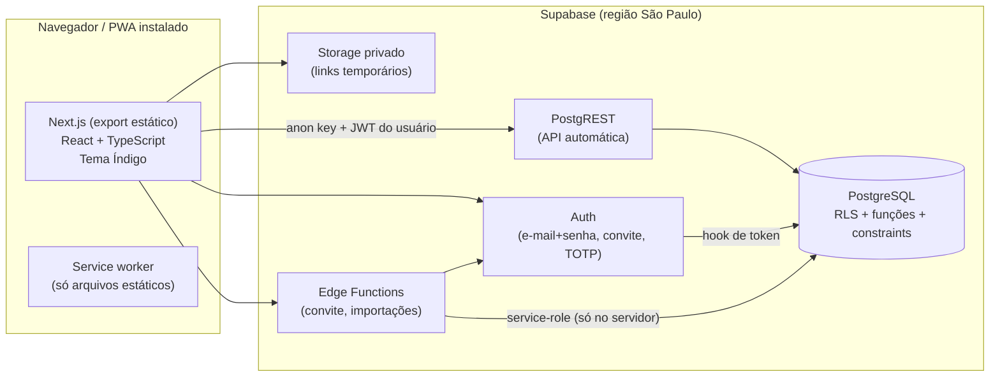
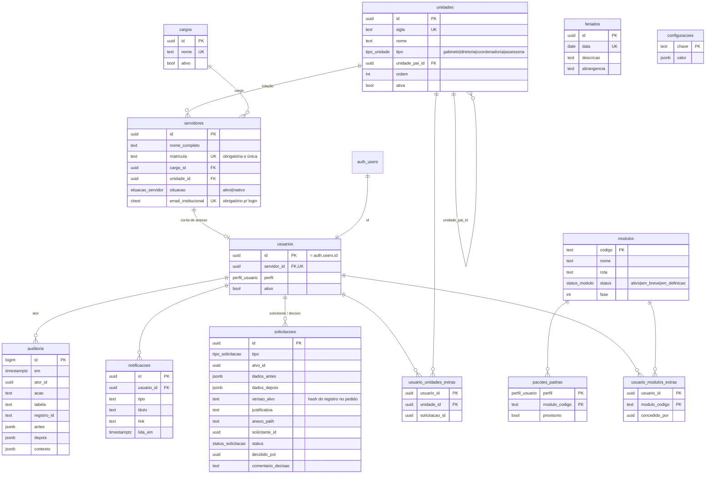
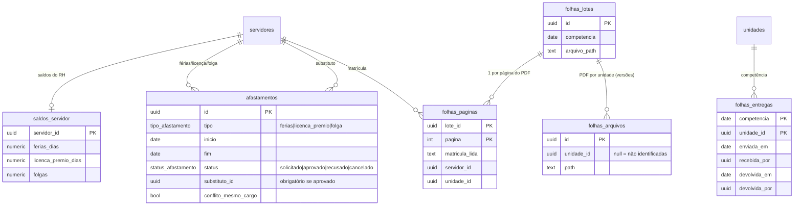
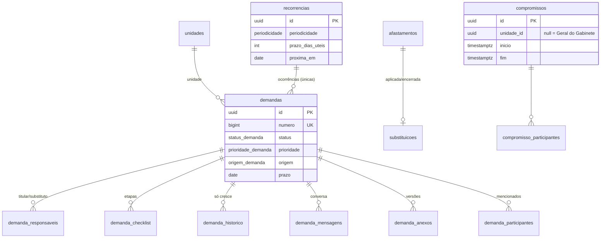
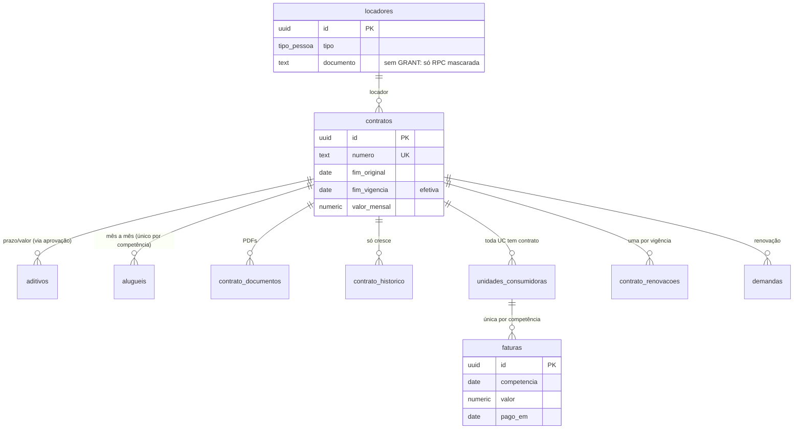
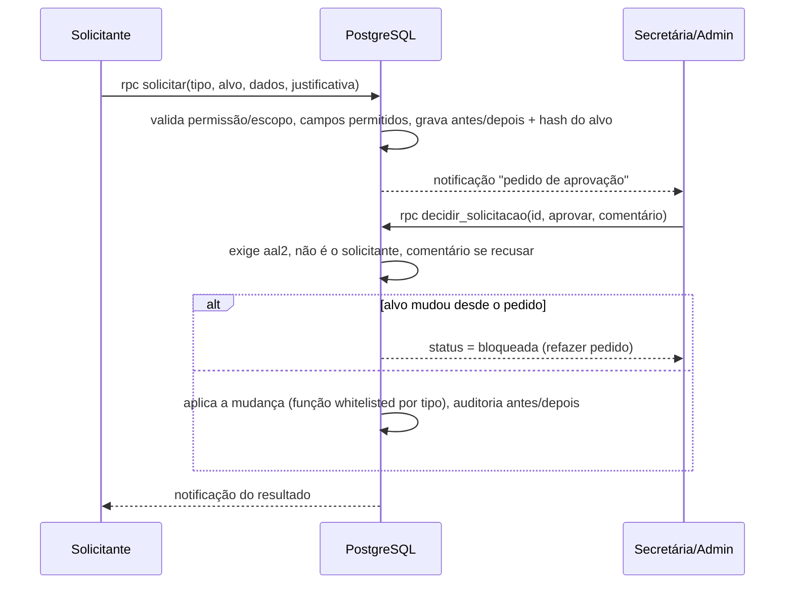

# Gestão SEMFAZ — Arquitetura

Documento vivo. Referência: `docs/PROMPT.md` (prevalece em caso de conflito) e protótipos em `docs/prototipos/`.

## 1. Visão geral



- **Frontend**: Next.js (App Router) com `output: 'export'`, hospedado no GitHub Pages. Só usa URL pública e anon key. Nenhuma regra de segurança depende da interface.
- **Backend**: Supabase. Regras de negócio e permissões no PostgreSQL (constraints, RLS, funções `SECURITY DEFINER` com `search_path` fixo). Dependências exclusivas do Supabase isoladas em: `auth.uid()`/`auth.jwt()` (encapsuladas no schema `app`), hook de token, Storage e Edge Functions.
- **Portabilidade**: toda regra está em SQL padrão; para migrar basta prover `auth.uid()`/`auth.jwt()` equivalentes (o arquivo `tests/db/shim/supabase_shim.sql` mostra o contrato mínimo, usado nos testes com PostgreSQL puro).
- **Módulos**: cada módulo = conjunto de migrations + tabelas + políticas + rotas. Novos módulos entram como novas migrations e um registro na tabela `modulos`, sem alterar os existentes.

## 2. Estrutura de pastas

```
gestao-semfaz/
├── CLAUDE.md, COMECE-AQUI.md
├── docs/
│   ├── PROMPT.md               especificação (fonte da verdade)
│   ├── architecture.md         este documento
│   ├── PROJECT_STATUS.md       fase atual, decisões, pendências
│   ├── lgpd.md                 dados tratados (rascunho p/ DPO)
│   ├── seguranca/              revisões OWASP por fase
│   └── prototipos/             referência visual obrigatória
├── supabase/
│   ├── config.toml             auth (sem cadastro público, senha forte, MFA, limites)
│   ├── migrations/             SQL versionado (fonte do banco)
│   ├── seed.sql                dados FICTÍCIOS de desenvolvimento
│   └── functions/              Edge Functions (Deno)
│       └── convidar-usuario/  arquivo único (CORS, validação, erros genéricos)
│   └── deploy/banco-completo.sql  migrations juntas p/ o SQL Editor (gerado)
├── scripts/
│   ├── criar-primeiro-admin.mjs  script local (service-role via env)
│   ├── csp.mjs                   pós-build: CSP com hashes dos scripts inline
│   └── db-test-setup.sh          sobe banco de teste local
├── public/                     manifest, ícones, service worker
├── src/
│   ├── app/                    rotas (login, painel, aprovações, usuários, calendário/feriados, relatórios/auditoria…)
│   ├── components/
│   │   ├── layout/             AppShell, Sidebar, Header, Busca geral, Notificações
│   │   └── ui/                 Botão, Cartão, Selo, Campo, Tabela responsiva, Estado vazio
│   ├── lib/                    cliente Supabase, sessão, módulos, validação, formatação
│   └── styles/                 tokens do tema Índigo + estilos globais
└── tests/
    ├── db/                     testes de RLS/funções direto no banco (como a API faz)
    └── unit/                   testes de utilitários do frontend
```

## 3. Modelo de dados (Fase 1)



Tabelas internas sem acesso pela API: `limites_requisicao` (limite de requisições das funções sensíveis).

### Fase 2 (acréscimos)



Fluxo das folhas de ponto: navegador lê o texto de cada página (pdf.js) → `criar_lote_folhas` cruza matrícula no banco → navegador monta um PDF por unidade (pdf-lib: folha de rosto + servidores em ordem alfabética) → upload no bucket privado `folhas-ponto` → `registrar_arquivos_folhas`. A chefia só baixa os arquivos das unidades do seu escopo (política do Storage segue `folhas_arquivos`).

### Fase 3 (acréscimos)



Rotina diária (pg_cron, 06:05 de Brasília): `app.rotinas_diarias_demandas()` cria as ocorrências recorrentes (sem duplicar), aplica e encerra substituições e avisa prazos próximos. A permissão de cada demanda está em uma função só (`app.pode_ver_demanda`), usada pelas políticas, pelo Storage e pelas RPCs.

### Fase 4 (acréscimos)



Acesso: `app.acesso_contratos()` (módulo contratos) para contratos e tudo ligado a eles; `app.acesso_ucs()` (contratos ou unidades consumidoras) para UCs e faturas. A rotina diária passa a chamar `app.rotina_contratos()`: cria a demanda de renovação aos 90 dias (uma vez por vigência) e avisa vencimento aos 90/60/30/15 dias. Alteração de contrato e aditivo entram por `public.solicitar_contrato` e são aplicadas pelo mesmo `decidir_solicitacao` (hash da versão do contrato).

`servidores` entra na Fase 1 só com o núcleo (necessário para usuários e para a regra da matrícula). Saldos, importação por planilha e folhas de ponto: Fase 2.

## 4. Perfis, escopo e módulos

- **Perfil** (`usuarios.perfil`): administrador, secretaria, diretor, coordenador, funcionario. Chefes de assessoria e da Coord. PAV usam `coordenador`.
- **Escopo de gestão** (`app.unidades_escopo()`): administrador/secretária = todas; diretor = sua diretoria e coordenadorias abaixo; coordenador = sua unidade; + unidades extras concedidas (via aprovação). Funcionário: só os próprios registros.
- **Módulos visíveis** (`app.modulos_do_usuario()`): pacote padrão do perfil (`pacotes_padrao`, **provisório** até a definição oficial) ∪ módulos extras (`usuario_modulos_extras`). Módulo extra libera o módulo; o escopo continua valendo nas políticas de cada tabela.
- **Gate de sessão** (`app.sessao_ok()`): usuário existe, está ativo, servidor ativo e — para administrador e secretária — sessão com MFA (`aal2`). Toda política começa por esse gate: desativar o usuário corta o acesso no próximo request, mesmo com token válido.

## 5. Fluxos principais

### Aprovações (6.9)

Tabelas protegidas (`unidades`, `cargos`, `servidores` (alteração), `usuarios` (perfil), `usuario_unidades_extras`, `feriados` (alteração/exclusão)) **não têm política de UPDATE/DELETE**: só mudam pelas funções de aprovação.

### Ações imediatas (sem aprovação, auditadas)
Liberar/retirar módulo extra; desativar/reativar usuário; cadastrar servidor novo; cadastrar feriado novo; convidar usuário. Todas exigem secretária ou administrador com sessão `aal2`.

### Autenticação
Sem cadastro público (`enable_signup = false`); convite via Edge Function `convidar-usuario`; recuperação por e-mail; TOTP obrigatório para administrador e secretária (aplicado no banco via `aal2`), recomendado para diretor (aviso na interface); hook `custom_access_token_hook` recusa token de usuário inativo e audita logins. Primeiro administrador: `scripts/criar-primeiro-admin.mjs` (local).

## 6. Plano de segurança

| Área | Medida | Onde |
|---|---|---|
| Autorização | RLS em **todas** as tabelas; sem política = sem acesso; `anon` sem privilégio nenhum | migrations `*_rls.sql` |
| Funções | `SECURITY DEFINER` + `set search_path = ''` + nomes qualificados; `EXECUTE` revogado de `public`/`anon` | todas as funções |
| Escritas sensíveis | Sem UPDATE/DELETE direto; só RPC com validação de perfil, escopo e campos | aprovações |
| Sessão | Gate `sessao_ok()` consulta o banco a cada request; MFA (`aal2`) para admin/secretária; JWT 1h; timebox de sessão | RLS + `config.toml` |
| Login | Limite de tentativas (rate limit do Auth), senha ≥ 12 com letras/dígitos/símbolos, sem cadastro público | `config.toml` |
| Funções de servidor | Valida JWT, permissão e corpo; CORS restrito a `ALLOWED_ORIGIN`; limite de requisições; erros genéricos | `supabase/functions` |
| Auditoria | Trigger em todas as tabelas de negócio; tabela imutável (trigger bloqueia UPDATE/DELETE/TRUNCATE, privilégios revogados) | `*_auditoria.sql` |
| Frontend | CSP restritiva (hashes dos scripts inline gerados no build), anti-clickjacking (frame-busting + `frame-ancestors` documentado), sem `dangerouslySetInnerHTML`, validação com zod | `scripts/csp.mjs`, `src/lib/validacao.ts` |
| Arquivos | Buckets privados, URLs assinadas curtas (60 s), caminho gerado pelo sistema, checagem de tipo real (assinatura do arquivo) + limite de tamanho; política do Storage segue a do registro | `*_storage.sql` |
| Segredos | `.env` ignorado; `.env.example` sem valores; service-role só em script local / Edge Function / secrets do Actions | `.gitignore` |
| Dependências | Dependabot + `npm audit` no CI | `.github/` |
| LGPD | Mínimo necessário; saldos/produtividade só para o próprio, chefia, secretária e admin; CPF/contato mascarados (Fase 4); nada pessoal em logs/erros | `docs/lgpd.md` |
| Testes | Testes diretos no banco com o papel `authenticated` + claims do JWT (o mesmo que a API faz) tentando ler/criar/alterar/apagar sem permissão | `tests/db` |

**Limitações da hospedagem estática (GitHub Pages)**: não permite cabeçalhos HTTP próprios → CSP via `<meta>` (não suporta `frame-ancestors`, `report-uri` nem `sandbox`); anti-clickjacking por script; HSTS depende do GitHub. CORS da API REST do Supabase hospedado não é configurável por projeto (proteção real = RLS). Recomendação antes de dados reais: hospedagem com cabeçalhos (Cloudflare Pages/Netlify ou infraestrutura da Prefeitura).

## 7. Ambientes

| Ambiente | Banco | Frontend | Dados |
|---|---|---|---|
| Desenvolvimento | Supabase local (`supabase start`) ou PostgreSQL + shim (testes) | `npm run dev` | fictícios (`seed.sql`) |
| Homologação | Projeto Supabase separado (São Paulo) | GitHub Pages / preview | fictícios |
| Produção | Projeto Supabase separado (São Paulo), backup diário | domínio oficial | reais só após validação de segurança e LGPD |
